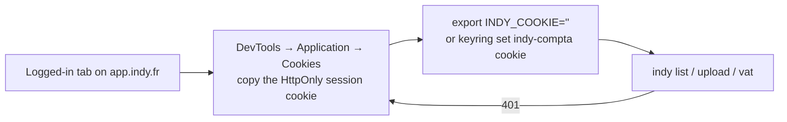

# indy-cli

Bun CLI for the unofficial Indy web API (`app.indy.fr`): list and filter transactions,
upload receipts, edit VAT. Endpoint reference: [`indy-web-api.md`](./indy-web-api.md).

```bash
bun install          # only dev deps (@types/bun, typescript)
bun test
bun run src/cli.ts --help
bun link             # optional: exposes `indy` on the PATH
```

## Auth

Indy runs with `enableClientInternalAuthSession: true`: the API authenticates with an
**HttpOnly session cookie**, and a Firebase ID token alone is rejected
(`401 {"code":"auth.unauthorized"}`). So the CLI borrows the cookie of a logged-in browser
session.



The cookie is named **`__Http-sid`**. Grab its value in DevTools →
_Application_ → _Storage_ → _Cookies_ → `https://app.indy.fr` → `__Http-sid`:

```bash
export INDY_COOKIE='<__Http-sid value>'
```

The value alone is enough; `__Http-sid=<value>` or a whole `Cookie:` header pasted from
_Network → Copy as cURL_ are accepted too.

Persist it in the OS keyring instead of the environment if you prefer:

```bash
keyring set indy-compta cookie      # the CLI reads it when INDY_COOKIE is unset
```

The session is not eternal: on `401` refresh the cookie the same way. Signing out in the
browser invalidates it.

`INDY_TOKEN` (Firebase ID token, IndexedDB `firebaseLocalStorageDb` →
`stsTokenManager.accessToken`) is still supported and sent as `Authorization: Bearer`, but
it only works if Indy turns the internal-session flag back off. Paste this in the DevTools
console of a logged-in `app.indy.fr` tab to read it out (the `__Http-sid` cookie is
HttpOnly, so it cannot be read this way — only the token can):

```js
// DevTools console, tab open on https://app.indy.fr
const idb = (req) =>
  new Promise((ok, ko) => {
    req.onsuccess = () => ok(req.result);
    req.onerror = () => ko(req.error);
  });
const db = await idb(indexedDB.open("firebaseLocalStorageDb"));
const rows = await idb(
  db
    .transaction("firebaseLocalStorage")
    .objectStore("firebaseLocalStorage")
    .getAll()
);
const token = rows.find((r) => r.value?.stsTokenManager?.accessToken)?.value
  .stsTokenManager.accessToken;
if (!token)
  throw new Error("no Firebase token in IndexedDB — are you logged in?");
copy(`export INDY_TOKEN='${token}'`); // shell line now in the clipboard
console.log(token);
```

The token is short-lived (~1 h); re-run the snippet on `401`.

`INDY_ORG_ID` is optional: the SPA only sends `x-organisation-id` when an accountant
impersonates an organisation. For your own account the organisation comes from the session.

## Commands

```bash
# Transactions without a receipt, first quarter, as TSV
indy list --no-receipt --from 2026-01-01 --to 2026-03-31 --all --tsv > sans-justificatif.tsv

# Same list, paged, aligned text (default)
indy list --no-receipt --page 2

# One transaction with its subdivisions (needed to get subdivision ids)
indy get <transactionId>

# Upload receipts and attach them to a transaction
indy upload <transactionId> ~/factures/2026-03-free.pdf

# Receipt housekeeping
indy receipts <transactionId>
indy detach <receiptId>            # unlink a wrongly suggested receipt
indy apply-receipt <receiptId>     # push the OCR amount/date/VAT onto the transaction
indy unpaired

# Set the VAT rate of a single-category transaction (2000 = 20 %)
indy vat <transactionId> --rate 2000

# Ventilate a multi-rate ticket: 25,33 € at 20 % + 4,66 € at 10 %
indy split <transactionId> --line -25,33:626100:2000 --line -4,66:626100:1000

# Reference data
indy filters
indy vat-config --date 2026-09-01
```

Notes:

- **Rates are basis points**: `2000` = 20 %, `1000` = 10 %, `550` = 5,5 %, `0` = exonéré.
- **Amounts are signed euros** on the command line (expenses negative), converted to cents
  for the API. `split` refuses to send lines that do not sum to the transaction amount
  unless `--force` is passed.
- TSV output (tab-separated, decimal commas) opens as a table in Sheets, DuckDB or Zed.
- `--all` walks every page (30 transactions per request).

## Layout

| File                 | Role                                                  |
| -------------------- | ----------------------------------------------------- |
| `src/client.ts`      | HTTP client, endpoint methods, query/amount helpers   |
| `src/format.ts`      | TSV and aligned-text rendering                        |
| `src/cli.ts`         | argument parsing and commands                         |
| `src/client.test.ts` | `bun test` — query serialization, amount parsing, TSV |

Unofficial API: Indy can change routes and payloads without notice.

## Disclaimer

Not affiliated with, endorsed by, or supported by Indy. The API it talks to is private and
undocumented: routes, payloads and the auth scheme can change or break without notice, and
using this tool is at your own risk. It acts as your own logged-in session and can modify
your accounting data (VAT splits, receipts) — check what a command does before running it
on real books.

## License

MIT — see [LICENSE](./LICENSE).
