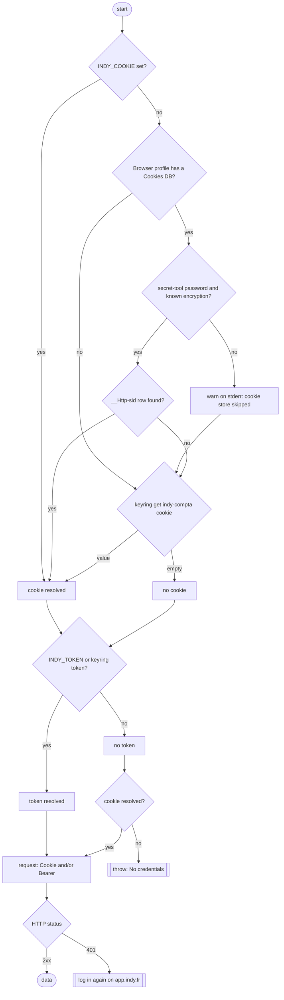
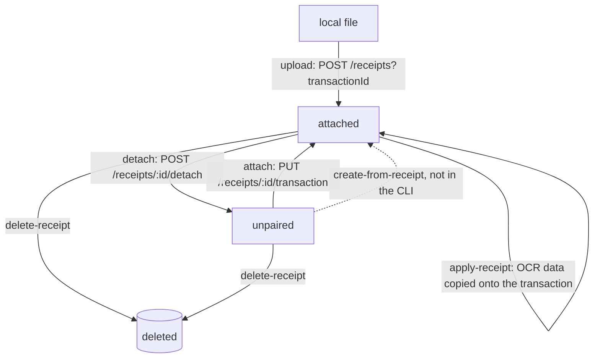
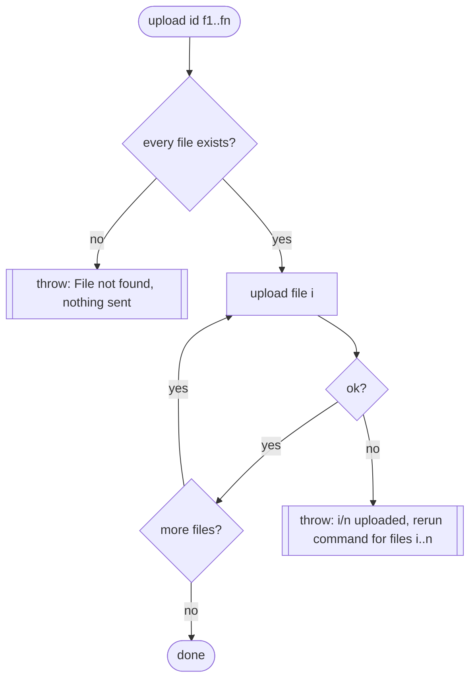
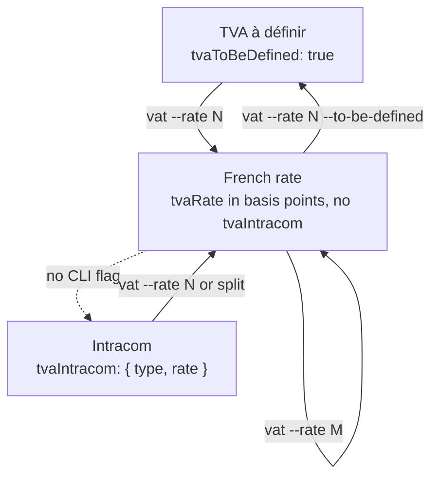
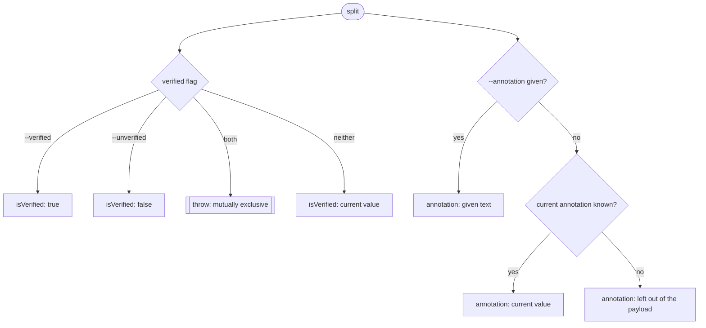
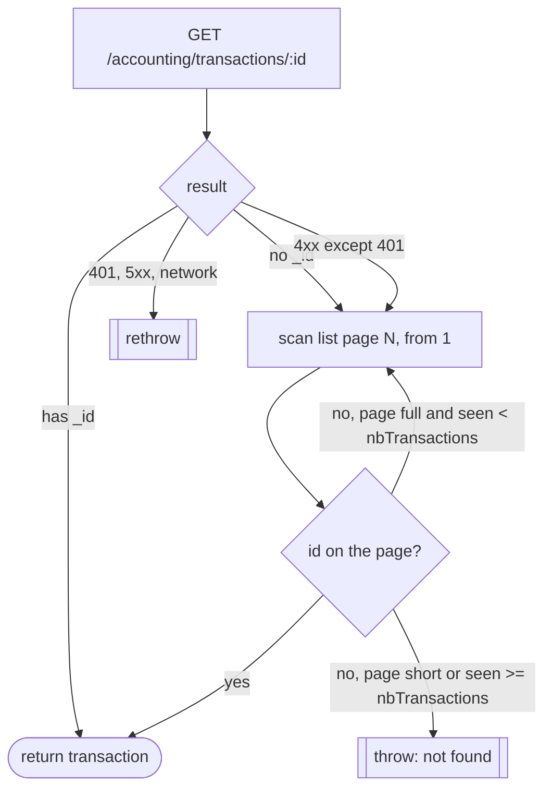
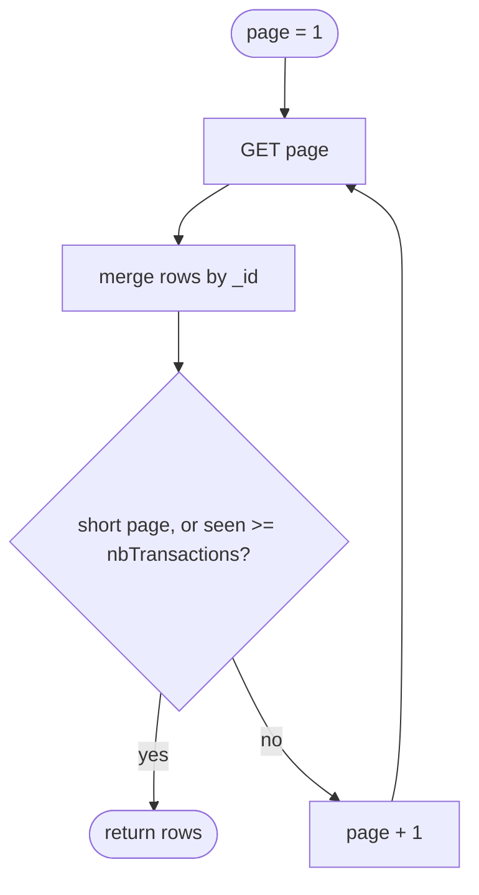
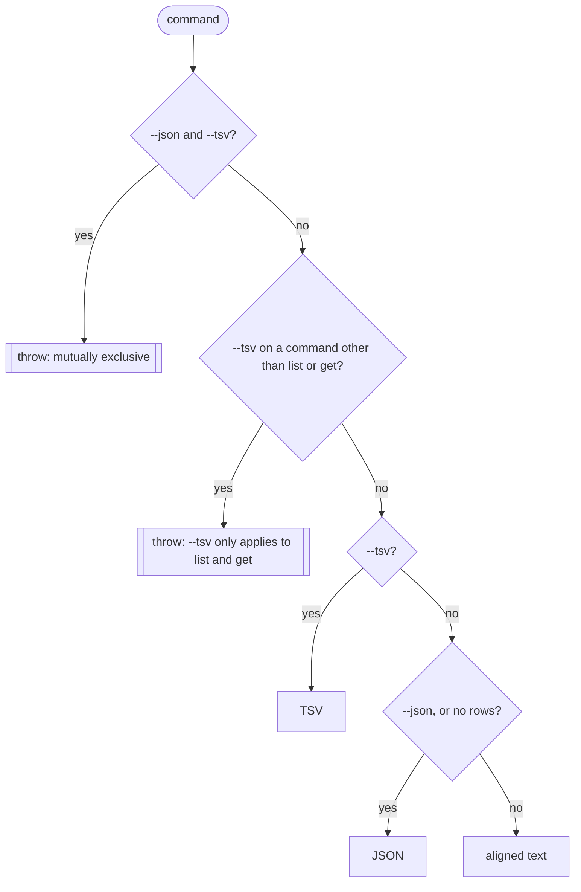

# Implicit state machines

indy-cli has no explicit state machine (no `state` enum, no transition
table). This file lists the 7 places where state and transitions are encoded
implicitly, in booleans, fallback chains or loops. Each section gives where
the logic lives, the states, the transitions, and its known limits.

First audited on `main` at `ef1302c`, 2026-11-01. The gaps found then are
fixed unless listed under "Limits"; the fixes are summarised at the end.

| #   | Machine                                                  | Where                                                        | Owner of the state |
| --- | -------------------------------------------------------- | ------------------------------------------------------------ | ------------------ |
| 1   | Credential resolution                                    | `src/cli.ts` `resolveCredentials`, `src/browser-cookie.ts`   | CLI, per run       |
| 2   | Receipt lifecycle                                        | `src/client.ts` receipts methods, `src/cli.ts` `upload` etc. | Indy server        |
| 3   | Subdivision VAT state                                    | `setVat`, `updateTransaction`                                | Indy server        |
| 4   | Transaction fields in `split` (`isVerified`, annotation) | `split` case                                                 | Indy server        |
| 5   | `getTransaction` lookup                                  | `src/client.ts`                                              | CLI, per call      |
| 6   | Pagination                                               | `listAllTransactions`, `getTransaction`                      | CLI, per call      |
| 7   | Tri-state flag pairs and output mode                     | `exclusive`, `listParams`, `output`                          | CLI, per run       |

## 1. Credential resolution

The cookie and the token are each resolved by a first-non-empty chain. The
client then picks its headers from which ones are set. The server decides
whether the session is still valid.

States per run: `cookie-only`, `token-only`, `cookie+token`, `none`. Server
side: `token-only` always gets `401` while `enableClientInternalAuthSession`
is on (see `indy-web-api.md`).

Decryption picks its branch from the value prefix: `v11` (libsecret key),
`v10` (`peanuts` key), any other `vNN` throws `Unsupported cookie
encryption`, anything else is plaintext. From meta version 24 it strips a
32-byte SHA-256 prefix. A cookie stored unencrypted (empty
`encrypted_value`) is read from the `value` column.

Limits:

- An expired cookie in the browser store still wins over a valid keyring
  cookie: the chain stops at the first non-empty value, not the first valid
  one. Only a `401` reveals it.

## 2. Receipt lifecycle

The server holds the state (`pairingStatus` on the receipt). The CLI fires
transitions without reading the current state first.

`upload` with several files is a small machine of its own:

Limits:

- No pre-condition check: `attach` on an already attached receipt, `detach`
  on an unpaired one, or `apply-receipt` on an unpaired one is sent as is.
  The server decides; its behaviour there is not documented.
- `attach` always sends `applyReceiptData: false`. Attach plus apply takes 2
  calls (`attach`, then `apply-receipt`).
- `apply-receipt` is a self-transition on the receipt but changes the
  transaction (amount, date, VAT). It can break a split that summed to the
  amount.
- `x-request-id` is a new UUID per call: the server cannot dedupe a rerun.
  The rerun command in the error lists only the files not yet uploaded.

## 3. Subdivision VAT state

Each subdivision carries `tva_rate`, `tvaToBeDefined` and an optional
`tvaIntracom`. Together they encode 3 states.

Limits:

- `--to-be-defined` still requires `--rate`, so the CLI sends a rate and
  `tvaToBeDefined: true` together. Which one wins is up to the server.
- No CLI path reaches the intracom state; `setVat` accepts `tvaIntracom`
  but `cli.ts` never passes it.
- `vat` without `--subdivision` only works with exactly 1 subdivision where
  `modifiable !== false`; 0 or 2+ throws.
- `split` always writes `tvaToBeDefined: false`: it leaves the "à définir"
  state on every line.

## 4. Transaction fields in `split`

`split` rebuilds the whole `info` object. For each field the new value is
the flag if given, else the current value. It looks the transaction up with
`deleted: "both"`, so a deleted transaction is found too (`vat` does the
same).

Limits:

- List responses carry no `annotation` field, so in practice the "left out"
  branch is the common one. It relies on the server keeping the annotation
  when the field is absent; not verified live, because `split` writes real
  books.

## 5. `getTransaction` lookup

2 phases with a fallback. Only a 4xx other than `401` moves to phase 2
(`isScanFallback`).

## 6. Pagination

`listAllTransactions` state: `page`, `seen`, rows keyed by `_id`. It stops
on a short page or when `seen >= nbTransactions`.

Limits:

- Offset paging: a transaction added or deleted between 2 pages shifts the
  offset. Deduplication by `_id` removes a repeated row, but a row can still
  be skipped. A date-bounded filter (`--from`, `--to`) avoids it.

## 7. Tri-state flag pairs and output mode

3 filters are tri-state values stored as 2 booleans. `exclusive()` maps
each pair to `true` / `false` / unset and throws when both are given.

| Filter                  | Flags                             | Both given |
| ----------------------- | --------------------------------- | ---------- |
| `hasReceipt`            | `--with-receipt` / `--no-receipt` | throws     |
| `displayIngressOutflow` | `--income` / `--expense`          | throws     |
| `verified`              | `--verified` / `--unverified`     | throws     |

Output mode, from `main` and `output()`:

## Fixes from the 2026-11-01 audit

1. `split` erased the annotation: it sent `""` when `--annotation` was
   absent. Now it keeps the current one, or leaves the field out (§4).
2. `split` could not clear `isVerified`: it now takes `--unverified` (§4).
3. `vat` and `split` could not find a deleted transaction: they now look
   up with `deleted: "both"` (§4).
4. A `browserCookie` throw aborted the credential chain: it now warns and
   falls through to the keyring and `INDY_TOKEN` (§1).
5. Unknown cookie encryption versions came back as garbage; unencrypted
   cookies came back empty (§1).
6. `upload` partial failure gave no report: it now checks every file first,
   and on failure says how many went through and what to rerun (§2).
7. `getTransaction` turned a `401` or `5xx` into a full list scan, and
   fetched an extra empty page when the total was a multiple of 30 (§5).
8. `listAllTransactions` could return a row twice across shifted pages (§6).
9. Contradicting flag pairs resolved by code order, and `--tsv` on a
   command without rows printed JSON silently (§7).
