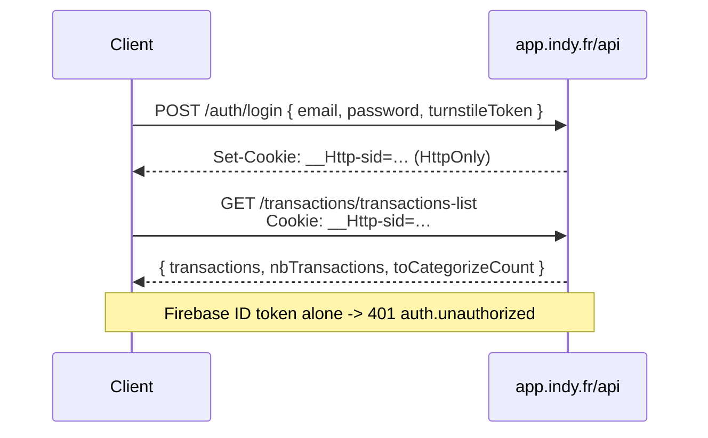
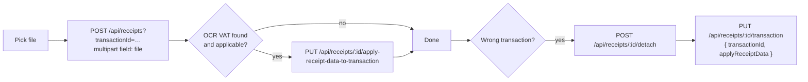
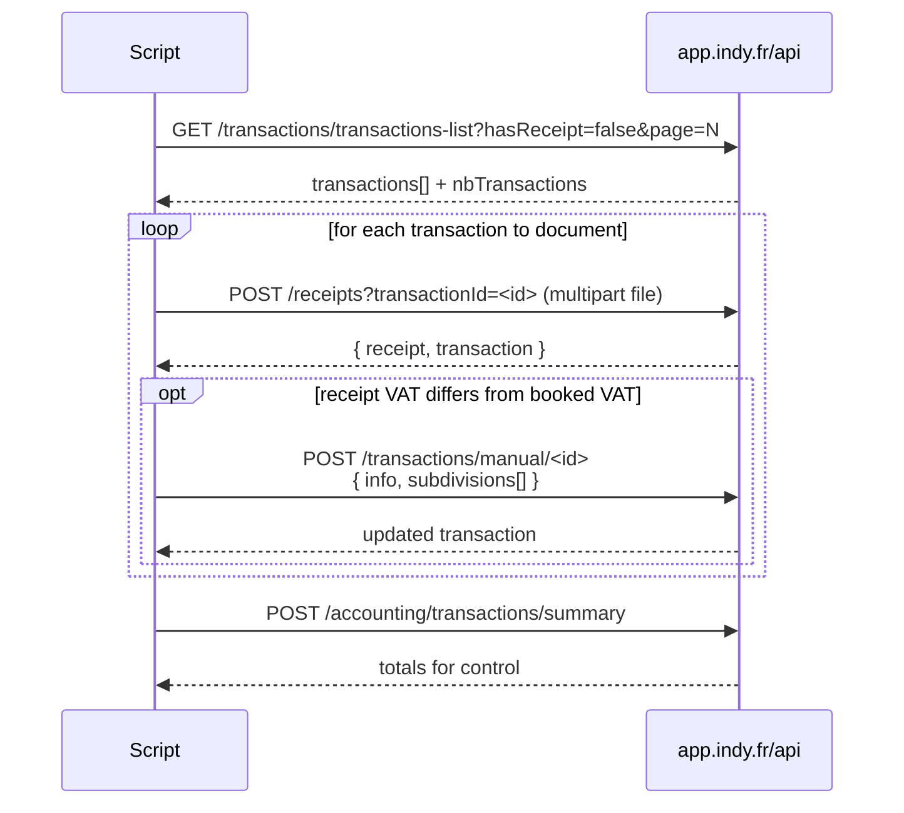

# Indy web API — transactions, receipts, VAT

Reverse-engineered from the `app.indy.fr` SPA bundles (release `5feaba9f`, captured 2026-09-08)
plus live request capture on `https://app.indy.fr/transactions`. Unofficial and unversioned:
Indy can change any of it without notice.

## Transport and auth

| Item | Value |
|---|---|
| Base URL | `https://app.indy.fr/api` (axios `baseURL: "/api"`) |
| Auth (current) | **HttpOnly session cookie `__Http-sid`** — the `enableClientInternalAuthSession` feature flag is on in production, so the SPA sends no bearer token |
| Auth (legacy path) | `Authorization: Bearer <Firebase ID token>`, used only while that flag is off |
| Org scoping | `x-organisation-id`, `x-active-organisation-id` — read from `sessionStorage`, set only when an accountant impersonates an organisation (`?imiter=`) |
| Client tags | `x-client-app-type`, `x-client-session-id`, `x-client-tab-id`, `x-client-release` |
| Optional | `x-sudo-token` (support impersonation), `x-request-id` (receipt upload idempotency) |
| Array params | `qs` with `arrayFormat: "brackets"` → `categories[]=606100&categories[]=613200` |

Verified against production on 2026-09-08, same endpoint, same valid Firebase token:

| Request | Result |
|---|---|
| Bearer only, `credentials: "omit"` | `401 {"code":"auth.unauthorized"}` |
| Session cookie `__Http-sid` only | `200` |
| Cookie + bearer | `200` |

So a script must carry the session cookie of a logged-in browser session, or log in itself
via `POST /api/auth/login` `{ email, password, turnstileToken, mfaVerifyPayload, h: false }`,
which sets the cookie (Turnstile captcha and MFA apply). Related routes: `/api/auth/sign-out`,
`/api/auth/exchange-sso`, `/api/auth/oauth/login/{google,apple}/redirect`,
`/api/auth/verify-auto-login-code`.



## 1. Listing and filtering transactions

`GET /api/transactions/transactions-list`

Query parameters (all optional except `page`):

| Param | Type | Notes |
|---|---|---|
| `page` | int | 1-based, **30 transactions per page** |
| `search` | string | full-text on description |
| `categories[]` | string[] | accounting account numbers (e.g. `626100`) |
| `bankAccountIds[]` | string[] | from the filters endpoint |
| `transactionTypes[]` | string[] | from the filters endpoint |
| `dateFrom`, `dateTo` | `YYYY-MM-DD` | inclusive range |
| `amountFrom`, `amountTo` | number (euros) | absolute amounts |
| `hasReceipt` | bool | `false` = "Sans justificatif" |
| `displayIngressOutflow` | `ingress` \| `outflow` | income / expense |
| `deleted` | `yes` \| `no` \| `both` | default: not deleted |
| `verified` | `yes` \| `no` | "transaction vérifiée" toggle |
| `vatType[]` | string[] | VAT nature filter |
| `vatRate[]` | int[] | **basis points**: `2000` = 20 % |

Response:

```json
{
  "transactions": [ { "_id": "...", "date": "...", "description": "...",
                      "amountInCents": -2999, "isVerified": false, "isDeleted": false,
                      "receiptIds": ["..."], "receipts": [...], "vat": {...},
                      "subdivisions": [ { "id": "...", "amount_in_cents": -2999,
                                          "accounting_account": {...}, "tva_rate": 2000,
                                          "tva_amount_in_cents": -500,
                                          "tva_nationality": {...}, "modifiable": true,
                                          "resource_links": [] } ] } ],
  "subdivisionResourceLinks": [],
  "nbTransactions": 336,
  "toCategorizeCount": 0
}
```

`nbTransactions` is the count **after** filtering — use it to drive pagination
(`ceil(nbTransactions / 30)` pages).

Companion endpoints:

| Method | Path | Purpose |
|---|---|---|
| GET | `/api/transactions/transactions-list-filters` | filter vocabulary: `allowedDates`, `bankAccounts`, `transactionTypes`, `categories`, `rangePresets`, `hasVatFilters` |
| POST | `/api/accounting/transactions/summary` | totals for the same filter set (different body shape, see below) |
| GET | `/api/transactions/transactions-pending-list` | pending (not yet booked) transactions |
| GET | `/api/transactions/to-categorize-count` | badge counter |
| GET | `/api/transactions/transactions-bound-dates?from[]=bankConnector` | min/max available dates |
| GET | `/api/transactions/:transactionId/history` | audit trail |
| GET | `/api/transactions/:transactionId/similar?accountingAccountNumber=` | similar transactions (bulk recategorisation) |
| POST | `/api/transactions/get-matching-receipts` | body `{ transactionIds: [...] }` |
| POST | `/api/transactions/get-matching-invoices` | body `{ transactionIds: [...] }` |
| DELETE | `/api/transactions/:transactionId` | soft delete |
| POST | `/api/transactions/:transactionId/resurrect` | undelete |

The summary endpoint uses a **different (snake-ish) filter body**, not the list query params:

```json
{
  "period": { "startDate": "2026-01-01", "endDate": "2026-03-31" },
  "accountingAccountNumber": ["626100"],
  "hasReceipts": "no",
  "vatType": [], "vatRate": [2000],
  "amountInCentsRange": { "above": 1000, "under": 500000, "displayIncomeExpense": "expense" },
  "fullText": "free",
  "bankAccountIds": [], "transactionTypes": [],
  "transactionIsDeleted": "both", "transactionIsVerified": "yes"
}
```

## 2. Receipts (justificatifs)

| Method | Path | Body / query | Purpose |
|---|---|---|---|
| GET | `/api/receipts/transaction` | `?transactionId=` (or `pendingTransactionId` + `pendingTransactionOrigin`) | receipts attached to a transaction |
| POST | `/api/receipts` | `multipart/form-data` field `file`; query `transactionId` (or the pending pair) | **upload + attach in one call** |
| PUT | `/api/receipts/:receiptId/transaction` | `{ transactionId, applyReceiptData }` | attach an existing receipt |
| POST | `/api/receipts/:receiptId/detach` | — | detach, keep the receipt |
| DELETE | `/api/receipts/:receiptId` | — | delete the receipt |
| PUT | `/api/receipts/:receiptId/apply-receipt-data-to-transaction` | — | push OCR amount/date/VAT onto the transaction |
| GET | `/api/receipts/unpaired` | — | receipts with no transaction |
| GET | `/api/receipts/:receiptId/matching-transactions` | — | suggestions for one receipt |
| PUT | `/api/receipts/:receiptId/receipt-data` | `{ receiptData, isVatDisabled }` | correct the OCR result |
| GET | `/api/receipts/:receiptId` | — | single receipt |
| POST | `/api/transactions/manual/create-from-receipt` | `{ receiptId, isExpense, description, accountingAccountNumber, isInCash }` | create a transaction from an orphan receipt |

Upload details, as the SPA does it:

```
POST /api/receipts?transactionId=<id>
Content-Type: multipart/form-data; boundary=...
x-request-id: <client uuid>

--boundary
Content-Disposition: form-data; name="file"; filename="facture.pdf"
Content-Type: application/pdf
...
```

Response: `{ receipt: {...}, transaction: {...} }`. The receipt object carries `pdf`/`image`
URLs, `pairingStatus`, `receiptData` (OCR: `date`, `amountInCents`, `description`,
`vat[] {rate, baseHt, vatAmountInCents}`, `polygons`) and
`canApplyVatReceiptDataToTransaction`.

Error codes worth handling: **415** unsupported type (only PNG/JPG/PDF), **413** file too large.



## 3. Editing VAT

Two paths, depending on the granularity.

### 3a. Quick VAT change on one subdivision

`POST /api/transactions/:transactionId/vat`

```json
{ "subdivisionId": "<id>", "tvaRate": 2000, "tvaToBeDefined": false }
```

`tvaRate` is in **basis points** (2000 = 20 %, 1000 = 10 %, 550 = 5,5 %, 0 = exonéré).
`tvaToBeDefined: true` is the "TVA à définir" state; `tvaIntracom` carries
`{ type, rate }` for intracom operations. Omit it for French VAT: since
2026-10 the API rejects `null` with `400 body/tvaIntracom must be object`.

### 3b. Full edit — description, date, amount, annotation, and the whole VAT split

`POST /api/transactions/manual/:transactionId` (the "Appliquer" button of the detail panel;
used for bank transactions too, not only manual ones)

```json
{
  "info": {
    "description": "Abonnement internet",
    "amountInCents": -2999,
    "date": "2025-10-06",
    "annotation": "",
    "isVerified": false
  },
  "subdivisions": [
    { "amountInCents": -2500, "accountingAccountNumber": "626100", "tvaRate": 2000,
      "tvaToBeDefined": false, "resourceLinks": [],
      "editDisplay": { "amountType": "TTC" } },
    { "amountInCents": -499,  "accountingAccountNumber": "626100", "tvaRate": 1000,
      "tvaToBeDefined": false, "resourceLinks": [],
      "editDisplay": { "amountType": "TTC" } }
  ]
}
```

Rules enforced client-side (the server rejects violations too):

- every subdivision needs a non-zero `amountInCents` **and** an `accountingAccountNumber`;
- subdivision amounts must sum to the transaction amount to the cent;
- amounts are signed (expenses negative) and expressed in cents;
- `editDisplay.amountType` is `TTC` | `HT` | `TVA` — it only says which field the user typed;
  `amountInCents` is always TTC;
- `tvaRate` is 0 when the organisation is not VAT-liable
  (`GET /api/vat/configuration?date=YYYY-MM-DD` → `{ isLiable, tvaSelected, tvaFrequency, zoneRegime }`).

This is the endpoint to use for a multi-rate receipt (one ticket with 10 % and 20 % lines):
send several subdivisions in one call.

Related, per-subdivision:

| Method | Path | Purpose |
|---|---|---|
| POST | `/api/transactions/:transactionId/subdivisions/:subdivisionId/accounting-account` | change category only |
| POST | `/api/transactions/subdivisions/accounting-account` | bulk recategorise `{ accountingAccountNumber, transactionsSubdivisionsToUpdate }` |
| GET | `/api/transactions/:transactionId/subdivisions/distribution` | current split, for copying |
| POST | `/api/transactions/subdivisions/distribution` | apply a split to similar transactions `{ transactionSourceId, similarTransactionIds }` |
| POST | `/api/transactions/:transactionId/annotation` | annotation / tags |
| POST | `/api/transactions/:transactionId/verification` | `{ isVerified }` |
| POST | `/api/transactions/:transactionId/date` | `{ newDate }` |
| GET | `/api/transactions/category-groups-with-decorations` | category tree for the picker |

## 4. End-to-end: "attach missing receipts and fix VAT"



## Gotchas

- **Rate scale**: `tvaRate` and the `vatRate[]` filter are in basis points, not percent.
- **Amounts**: cents everywhere in payloads (`amountInCents`), euros in the `amountFrom`/`amountTo`
  list filters. Signs matter — expenses are negative.
- **Page size is fixed at 30**; there is no `limit` parameter.
- `hasReceipt=false` returns transactions with no receipt, but Indy also *suggests* receipts from
  other transactions in the panel; a suggested receipt is not an attached one.
- The full-edit route is `/transactions/manual/:id` even for bank-sourced transactions.
- Deleted transactions are hidden by default; pass `deleted=both` to see them.
